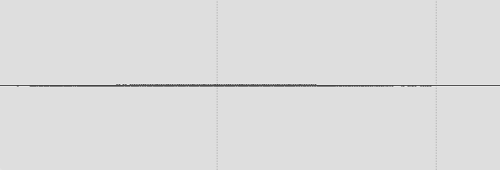
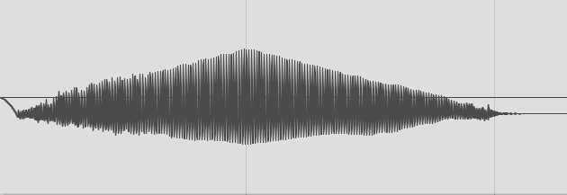
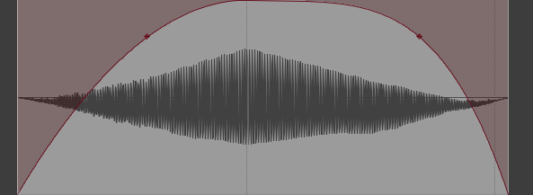
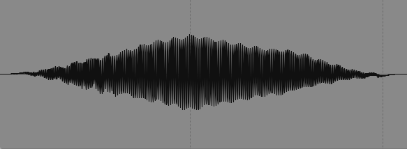

# Artifastring

Artifastring ("artificial fast string") is a highly optimized
physical simulation of string quartet instruments (violins,
violas, and cellos) for sound synthesis.

[Percival (2013) Physical Modelling meets Machine
Learning: Performing Music with a
Virtual String Ensemble](
https://percival-music.ca/research/phd-percival.pdf)

## Install

```bash
 git clone https://github.com/ktmeaton/artifastring
cd artifastring
docker build -t artifastring:latest .
docker run artifastring:latest actions2wav
```

```text
Usage: ./action2wav FILENAME.action {{OUTPUT_FILE}} {{INSTRUMENT_TYPE}} {{INSTRUMENT_NUMBER}} {{SAFE}}
```

## Quickstart

```bash
docker run -v $PWD:/opt/artifastring --rm artifastring:latest \
  actions2wav examples/violin-g-major.actions
```

## Instruments

| Instrument Type | Description | Instrument Number | Impulse |
| -- | -- | -- | -- |
| 0 | Violin | 0 | Violin I |
| 0 | Violin | 1 | Violin II |
| 0 | Violin | 2 | Violin III |
| 0 | Violin | 3 | Violin IV |
| 0 | Violin | 4 | Violin V |
| 1 | Viola | 0 | Viola I |
| 1 | Viola | 1 | Viola II |
| 2 | Cello | 0 | Cello I |
| 2 | Cello | 0 | Cello I |

>- Impulse wav files are in: `research/impulses/short-impulses`    
>- Impulse objects are in: `artifastring/constants/body_<instrument>_1.h`

A detailed overview of each instrument is provided in Percival (2013) Section 3.1 (p. 69)

```bash
docker run -v $PWD:/opt/artifastring -u $(id -u):$(id -g) --rm -it --entrypoint bash artifastring:latest

cd examples

actions2wav violin-g-major.actions violin-g-major_0.wav 0 0
actions2wav violin-g-major.actions violin-g-major_1.wav 0 1
actions2wav violin-g-major.actions violin-g-major_2.wav 0 2
actions2wav violin-g-major.actions violin-g-major_3.wav 0 3
actions2wav violin-g-major.actions violin-g-major_4.wav 0 4
```

## Actions

```text
action_type	seconds	parameters...
```

Lines must be divided with tabs, with one command per line.  A
line beginning with a `#` is a comment.

There are four types of commands. All commands begin with the `action_type` and `seconds`.  `seconds` is the absolute time since
the beginning of the audio, not the relative time since the last
command.

- **wait**: no extra parameters
  ```text
  w	2.0
  ```

- **finger**: 2 extra parameters: string number, and finger position
  ```text
  f	2.0	3	0.109101
  ```

- **pluck**: 3 extra parameters: string number, pluck position, and pluck force.
  ```text
  p	2.5	3	0.25	0.8
  ```

- **bow**: 4 extra parameters: string number, bow position, bow force, and bow velocity
  ```text
  b	3.0	3	0.12	0.6	0.4
  ```

- **accelerate** bow: 5 extra parameters: string number, bow position, bow force, target bow velocity, and bow acceleration
  ```text
  a	3.0	3	0.12	0.6	0.8	0.5
  ```

## Examples

```text
f	0.0	0	0.00
a	0.0	0	0.12	0.6	0.8	0.5
a	0.5	0	0.12	0.6	0.0	0.5
w	1.0
w	3.0
```

## Audio Processing

1. Gain too low.

    | Low Volume | Increase Clip Gain |
    | -- | -- |
    | | |

2. Assymetric phase.

    | Assymetric Phase | Trim and Fade | Rotate Phase 90 |
    | -- | -- | -- |
    |  |  |  |

## Workflow

### actions2wav

- Parse command-line arguments.
- Call `play_file` function
    - Initialize the `ArtifastringInstrument`
        - Parameters: `instrument_type`, `instrument_number`, `instrument_sample_rate`
        - Lookup the MULTIPLICATION_FACTOR
        - Populate the array of strings `artifastringString[st]` with `ArtifastringString`:
            - Parameters: `m_instrument_type`, `instrument_number`, `st`, `fs_multiply`, `instrument_sample_rate`
            - Calculate `fs` and `dt` based on multiplier and sample rate.
            - Calls `set_physical_constants`
                - Parameters: `violin_params[number][string_number]`, defined in ex. `constants/strings_violin.h`
                - Set `pc` to `pc_new`
                - Call `set_N` with `pc.N`
                    - Resizes arrays for `sc`, `vc`, `ss`, etc.
                    - N comes from the `String_Physical` struct"
                - Call `cache_pc_c` and set `vc.recache` to true.
                    - Calculates `sc.div_pc_L` and `sc.sqrt_two_div_L`
                    - Initializes an Artifastring Array (`AA`) of all ones with size `N`.
                    - Initializes an `AA` called `rn` that contains the values in `pc.rn[i]`, which is the "Array of modal decays" from the violin_params.
                    Updates values for various other `sc` variables.
            - Seed the random number generator with the current time.
            - Calls the `reset` function.
                - Calls the `cache_pc_c` function.
                - Sets `va`, `vc`, and `ss` variables to 0.
        - Initialize array of `lowpass_convolution` and `lowpass_input` for each string to `NULL`.
        - Initialize `convolution` for body to `NULL`.
        - For each string, setup `lowpass_time_data` (`LOWPASS_*`) and `lowpass_num_taps` (`NUM_TAPS_LOWPASS_*`)
        - Call function `resample_time_data`
            - Parameters: `lowpass_time_data`, `lowpass_num_taps`, `instrument_sample_rate`.
        - Assign `ArtifastringConvolution` to `lowpass_convolution` string.
            - Parameters: `fs_multiply`, `lowpass_time_data`, `lowpass_num_taps`
        - Calls `get_input_buffer` and assign to string `lowpass_input`.
            - Parameters: None
    - Initialize the `MonoWav`
        - Parameters: `filename`, `buffer_size`, `sample_rate`, `set_is_int`
        - Creates a buffer of short or int (`data_s` or `data_s`) and initializes all values to 0.
        - Initializes `index` and `total_samples` variable to 0.
        - Calls `prep_wav_file` function.
            - Parameters: `filename`, `sample_rate`, `is_int`
            - Writes wav file header.
            - Returns a `FILE` pointer (`fopen`) as the variable `outfile`.
    - Iterate over a vector of action `command_*` (ex. `command_bow`)
        - Call `waitUntil` function.
            - Call `wavfile->request_fill(delta)` based on `num_samples.
                - If `num_samples` is larger than buffer size, call `increase_size` to double it.
                    - Calls `writeBuffer`, then deletes current buffer data and creates a new array.
                        - Write values in `data_s` to disk, then reset buffer index.                    
                - If `num_samples` will go over buffer limit, call `writeBuffer`.
                - Returns a pointer `start_fill` and updates index.
            - Call `violin->wait_sample_forces`
                - Parameters: pointer to buffer `array`, `forces` (NULL), `delta`
                - Call `handle_buffer` for each remaining sample.
                    - Parameters: `output`, `forces` (NULL), `num_samples`
        - Call instrument action function (ex. `violin->bow`)
    - Delete instrument.
    - Delete wavfile.
        - Call `writeBuffer` function.
        - Write size of file at appropriate location.
        - Close file (`fclose`) and delete the buffer (`data_s`)

#### Frequency Multiplier

_"All instruments in this simulation output an audio signal at a sample rate of 22050 Hz, but this is
below the Nyquist rate for some the upper modes of some strings. Furthermore, as is discussed in
Section 2.3, the sample rate can significantly change the results of bowing a string. To mitigate these
problems, many strings are computed at a frequency which is an integer multiple of 22050 Hz. Each
string is computed at a frequency multiplier Mf (ranging from 1x to 4x), with the exact multipliers
listed in Section 3.5.2."_

```cpp
// 3 instruments, 4 strings each
const int FS_MULTIPLICATION_FACTOR[3][4] = {
    {2,2,4,4},
    {1,1,3,3},
    {1,1,1,2},
};

fs = fs_multiplier * instrument_sample_rate
dt = 1.0f /fs;
```


_When combining string signals, I first add signals of the same sample rate, then apply the filters
discussed below, then decimate the resulting signal by the relevant frequency multiplier. The resulting
signal(s) are summed, forming the final output. The entire process involves two filters: A low-pass
anti-alias filter to permit the downsampling, and the FIR body filter. Since both filters are linear
time-invariant, I combine them to form a single filter._


## Notes

The highest stable bow velocity for violin is `2.0`.
